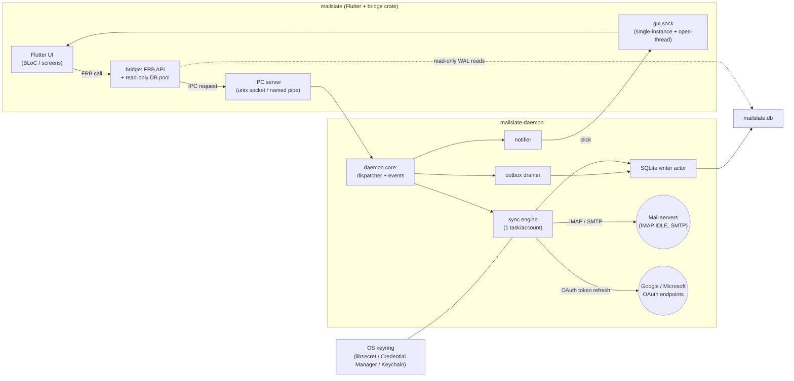
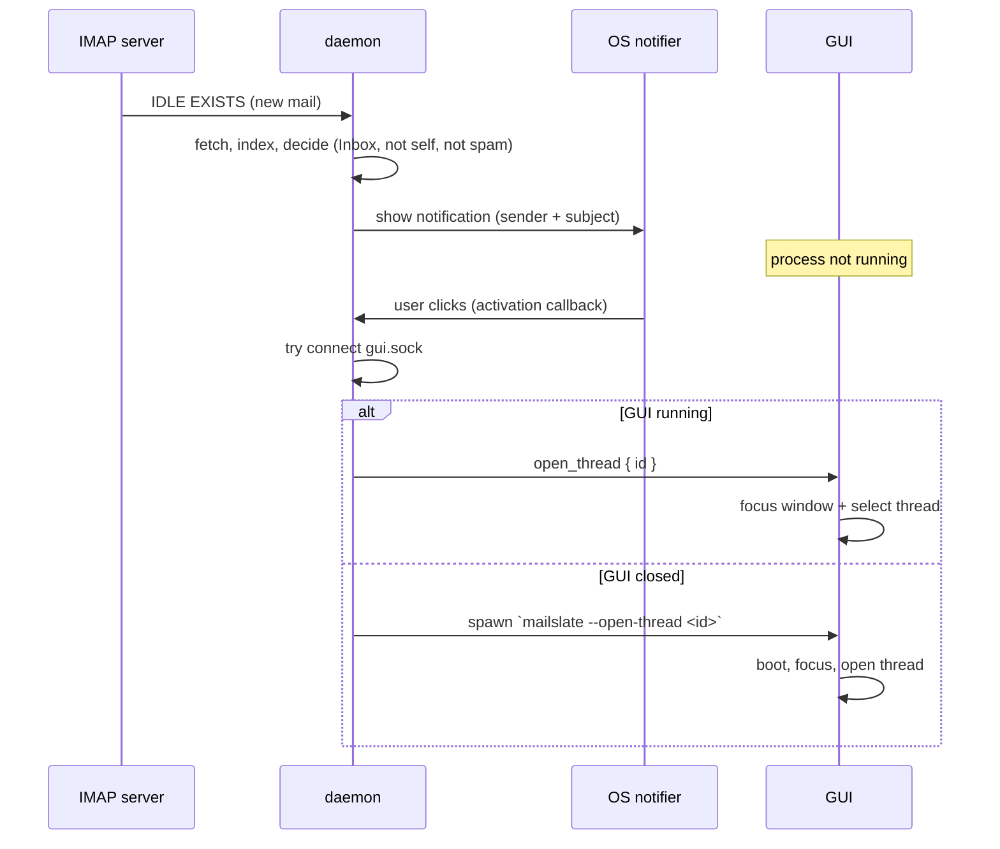

# ARCHITECTURE — MailSlate

| | |
|---|---|
| **Version** | 1.0 |
| **Date** | 2026-10-16 |
| **Status** | Approved — implements [PRD.md](PRD.md) v1 scope |
| **Related** | [PRD.md](PRD.md) · [USER_FLOW.md](USER_FLOW.md) · [DESIGN.md](DESIGN.md) · [DEVELOPMENT_ENVIRONMENT.md](DEVELOPMENT_ENVIRONMENT.md) · [PERFORMANCE_GUIDELINES.md](PERFORMANCE_GUIDELINES.md) |

---

## 1. System overview

MailSlate is **two cooperating processes** on one machine:

1. **`mailslate` (GUI)** — Flutter application. Owns presentation only: screens, BLoCs, design system. Its embedded Rust layer (`bridge` crate, loaded via `flutter_rust_bridge`) is a thin client: typed API surface for Dart + read-only SQLite access + IPC client to the daemon.
2. **`mailslate-daemon` (headless)** — Rust background service. Owns **all data logic**: IMAP/SMTP connections, OAuth2 + token lifecycle, the sync engine, the SQLite database (single writer), the outbox, and native OS notifications.

No MailSlate server exists. The only network endpoints are the user's own mail providers and OAuth endpoints.



Key invariants:

- **Single writer**: only the daemon writes `mailslate.db`. The GUI opens the same file read-only (WAL supports concurrent multi-process readers).
- **Daemon is the source of truth** for sync state; the GUI can outlive/restart independently.
- **Secrets never leave the daemon**: OAuth tokens and passwords live only in the OS keyring, accessed by the daemon.

---

## 2. Process model

### 2.1 Daemon lifecycle

| Concern | Behavior |
|---|---|
| Start | On login via autostart entry (systemd `--user` / LaunchAgent / HKCU Run). If absent or stopped, the GUI spawns it on demand. |
| Registration | Listens on IPC endpoint (see §5). Writes a launch log, sets a PID file for diagnostics. |
| Single instance | Second `mailslate-daemon` start detects the live socket and exits with code 0 (idempotent start). |
| Stop | Explicit only: Settings → *Stop background service*, or OS service manager. Quitting the GUI never stops the daemon. |
| Crash | Autostart supervisor restarts (systemd `Restart=on-failure`, launchd `KeepAlive`, Run-key + GUI health check spawns after crash). DB integrity guaranteed by WAL; outbox resumes from `inflight` state (§9.6). |
| Upgrade | New version replaces binary and asks the daemon to `shutdown`; autostart respawns. Schema migrations run at daemon startup (§7.4). |

### 2.2 GUI lifecycle

| Concern | Behavior |
|---|---|
| Start | Connect to daemon (spawn if needed) → FRB init → load cached views (read-only DB) → subscribe to event stream. |
| Single instance | GUI binds `gui.sock`. A second launch connects to it, sends `focus`, and exits. |
| Close window | Quits the GUI process. One-time hint: *"MailSlate keeps syncing in the background — manage in Settings."* |
| Deep start | `mailslate --open-thread <id>` (from notification click when GUI was closed) opens that thread after boot. |
| Daemon down | Banner: *Background service not running* + Start button. Reads still work from the DB; mutations and fresh sync pause. |

### 2.3 Notification click path (GUI closed)



---

## 3. Cargo workspace & crate map

`rust/` is a Cargo workspace:

| Crate | Type | Responsibility | Depends on |
|---|---|---|---|
| `mailslate-core` | lib | Domain + infra: sync engine, IMAP/SMTP adapters, OAuth, DB writer/read pool, keyring, MIME, threading, search, outbox, notifier. | external crates only |
| `mailslate-protocol` | lib | IPC message types (serde), framing codec, protocol version const. | serde |
| `mailslate-daemon` | bin | Wires core + protocol: IPC server, dispatcher, event fan-out, autostart management, logging. | core, protocol |
| `mailslate-bridge` | cdylib | FRB surface for Flutter: thin conversion layer, read-only DB pool, IPC client, event stream bridging. | core (types only where possible), protocol |

**Dependency rule (strict):** `daemon → core ← bridge`; `bridge` must NOT run sync logic and must NOT write the DB. `core` never imports FRB or daemon types. `protocol` is standalone.

### 3.1 `mailslate-core` module map

```
core/src/
  domain/
    accounts.rs      # account model, lifecycle states, settings
    sync/
      engine.rs      # per-account actor: state machine + command handling
      initial.rs     # initial sync pipeline (mailbox queue, envelope batches)
      incremental.rs # CONDSTORE/QRESYNC deltas, UID-range fallback, IDLE
      backfill.rs    # body backfill queue (recent 30d → window), on-demand fetch
    mailbox.rs       # mailbox/view model, canonical view mapping, archive semantics
    threading.rs     # JWZ-style clusterer (X-GM-THRID fast path), denorm recompute
    compose.rs       # draft model, send pipeline orchestration, dedupe rules
    search.rs        # FTS query builder (syntax subset → FTS5 MATCH), ranking, snippets
    events.rs        # internal broadcast bus (typed domain events)
    outbox.rs        # op model, state machine, idempotent replay, ordering
  infra/
    imap/            # async-imap adapter: connect, auth (XOAUTH2/LOGIN), fetch, IDLE,
                     # STORE/MOVE/APPEND, capability cache, per-server quirks
    smtp/            # lettre adapter: XOAUTH2 + password, Message-ID stamping
    oauth/           # PKCE + state, loopback listener (tiny_http), token exchange,
                     # refresh scheduler, provider configs (google, microsoft)
    db/
      writer.rs      # single writer actor (mpsc + batched txns)
      pool.rs        # small read pool (readonly connections)
      migrations/    # embedded SQL migrations (include_str!), runner
      queries/       # typed query modules (one per table group)
    mime.rs          # mail-parser wrapper: parse headers/structure/text/html
    sanitize.rs      # ammonia allow-list policy for untrusted HTML
    blobs.rs         # content-addressed store (raw .eml + attachments), GC
    keyring.rs       # keyring crate wrapper: store/get/delete account secrets
    notify.rs        # OS notifications: notify-rust / tauri-winrt-notification /
                     # mac-notification-sys + click callbacks
    autostart.rs     # install/remove/query autostart entries (3 OSes)
```

Domain ↔ infra inverted via traits where the domain needs to emit I/O: `ImapClient`, `SmtpSender`, `TokenSource`, `KeyStore`, `BlobStore`, `Notifier`, `Clock`. Concrete adapters injected by daemon at startup; fake impls in unit tests.

---

## 4. Flutter application structure

```
lib/
  main.dart                 # bootstrap: FRB init, DI, runApp
  core/
    ffi/                    # thin wrapper over FRB-generated bindings (lib/src/rust/)
      client.dart           # typed facade: every FRB call through one class
      events.dart           # AppEvent stream → typed Dart stream
      generated/            # (FRB output lives in lib/src/rust/, vendored)
    di/                     # get_it + injectable registrations
    failures/               # sealed AppFailure hierarchy + mapper from BridgeError
    theme/                  # DesignTokens → ThemeData (light/dark), typography
    routing/                # route table, deep-link handler (--open-thread)
    logging/                # dev logger facade
    widgets/                # shared primitives (buttons, chips, banners, empty states)
  features/
    shell/                  # 3-pane scaffold, sidebar, split panes, status banners
    accounts/               # wizard, account settings, connection test UI
    mailbox/                # conversation list, grouping header, bulk selection
    reader/                 # thread view, message cards, attachments, images banner
    composer/               # composer route, recipient chips, draft controller
    search/                 # search screen, filter chips, results list, syntax help
    settings/               # settings panes (general, accounts, about)
```

Per feature folder: `domain/` (entities, repository interfaces, use-cases where useful) → `data/` (repository implementations over `FfiClient`) → `presentation/` (BLoC + widgets + screens) + `README.md`.

**Rules:**

- BLoCs depend on repository interfaces only — never on `FfiClient` or generated bindings directly. Everything is unit-testable with mock repositories.
- Domain entities are Dart `freezed` classes; mapping from FRB DTOs happens in `data/`.
- One BLoC per screen-surface; the global `AppEventsBloc` merges the FRB event stream into invalidation signals; feature BLoCs subscribe selectively (see [PERFORMANCE_GUIDELINES.md](PERFORMANCE_GUIDELINES.md) §5).
- Errors: repositories catch `BridgeError` → map to `AppFailure` (`Network`, `AuthExpired`, `AuthFailed`, `ServerRejected`, `NotFound`, `Storage`, `DaemonUnavailable`, `Validation`, `Internal`) → BLoC state branches render banner/toast/dialog/inline per [USER_FLOW.md](USER_FLOW.md) error tables.

---

## 5. IPC protocol (GUI ⇄ daemon)

### 5.1 Transport & framing

| | |
|---|---|
| Linux/macOS | Unix domain socket `<data_dir>/daemon.sock` |
| Windows | Named pipe `\\.\pipe\mailslate` |
| Permissions | Unix: dir `0700`, socket `0600`, peer-UID check; Windows: default pipe ACL = creating user |
| Framing | `u32` little-endian length prefix + UTF-8 JSON object (v1). Hard cap 64 MiB per frame — large payloads always cross as **file paths** (staged blobs), never inline bytes. |
| Upgrade path | Framing/codec is isolated in `mailslate-protocol`; bincode variant can be added behind `protocol_version` bump (documented future optimization). |

### 5.2 Message envelope

```jsonc
// request (client → daemon)
{ "id": 42, "method": "mutate", "params": { ... } }
// response (daemon → client, same id)
{ "id": 42, "ok": true, "result": { ... } }        // or
{ "id": 42, "ok": false, "error": { "kind": "network", "message": "...", "retryable": true } }
// event (daemon → all subscribed clients)
{ "event": "mail_new", "data": { ... } }
```

Handshake: first request is always `ping` → `{ protocol_version: 1, daemon_version: "x.y.z" }`. Version mismatch → GUI shows an update-required screen; no partial compatibility.

### 5.3 Methods (v1)

| Method | Params → Result | Notes |
|---|---|---|
| `ping` | `{}` → version info | Health + version check |
| `get_status` | `{}` → per-account state snapshot | Initial UI hydration |
| `sync_now` | `{ account_id? }` → `{}` | Manual trigger |
| `start_oauth` | `{ provider }` → `{}` | Daemon opens flow; emits `oauth_url_ready` |
| `add_imap_account` | `{ conn, creds }` → `{ account_id }` | Creds in-memory → keyring by daemon |
| `complete_oauth_account` | `{ display_name, color?, sync_window_days? }` → `{ account_id }` | Called by GUI after `oauth_completed` |
| `remove_account` | `{ account_id, delete_data }` → `{}` | Data deletion runs in writer txn |
| `update_account` | `{ account_id, patch }` → `{}` | Display name, color, window, notifications |
| `mutate` | `{ op }` → `{ outbox_id }` | Flags/move/archive/delete/tags/drafts (append to outbox) |
| `send` | `{ draft }` → `{ outbox_id }` | Attachment blob paths staged by GUI first (`stage_attachment`) |
| `stage_attachment` | `{ file_path }` → `{ blob_ref, name, size, mime }` | GUI copies user file into staging; daemon validates |
| `shutdown` | `{}` → `{}` | Explicit stop (Settings) |
| `register_gui` | `{ gui_socket }` → `{}` | GUI announces its push socket (open-thread, focus) |

### 5.4 Events (daemon → GUI)

`mail_new` · `sync_progress{account, mailbox, phase, done, total}` · `account_status{state, last_error?}` · `auth_expired{account}` · `outbox_changed{account, pending, failed}` · `counts_changed{vie`ws}` · `thread_changed{thread_id}` · `mailboxes_changed{account}` · `oauth_url_ready{url}` · `oauth_completed{account_pending, email}` · `oauth_failed{reason}` · `open_thread{thread_id}` (pushed to GUI socket).

Delivery guarantees: events are **coalesced invalidations**, not a journal — a dropped/coalesced `thread_changed` is harmless because the GUI re-reads from the DB. Ordering per client is FIFO per connection.

---

## 6. FRB surface (`mailslate-bridge` → Dart)

FRB v2 generates async Dart functions and stream bridges. The API is deliberately coarse (page-level reads, op-level writes) to keep IPC/FFI chatter low.

```
api/
  system.rs      init_app(), daemon_status(), start_daemon(), app_events() -> Stream<AppEvent>
  accounts.rs    list_accounts(), add_imap_account(), start_oauth(), complete_oauth_account(),
                 test_connection(), update_account(), remove_account(), start_reauth()
  mailboxes.rs   list_mailboxes(), list_canonical_views(), threads_page(view|custom, cursor),
                 thread_detail(thread_id), message_bodies(thread_id), fetch_attachment(att_id)
  actions.rs     set_flags(), move_messages(), archive_messages(), trash_messages(), delete_forever(),
                 set_spam(), set_tags(), create_tag(), rename_tag(), delete_tag()
  compose.rs     save_draft(), discard_draft(), send_draft(), stage_attachment(), autocomplete_recipients()
  search.rs      search(query, filters, cursor)
  settings.rs    get_settings(), set_settings(), set_autostart(), stop_daemon()
```

- All functions async; long operations (initial sync) are not awaited — they emit `sync_progress` events.
- `threads_page` uses **keyset pagination** `(last_date, thread_id)` — never OFFSET.
- `fetch_attachment` returns a **local file path** (ensures blob is downloaded); the GUI opens/saves it via the OS.
- Typed errors: every fallible function returns `Result`; FRB maps to an exception carrying `BridgeError { kind, message, retryable }`.

Generated files: `lib/src/rust/` (Dart) and `rust/rust_builder/` (FFI plugin shim) are **committed**, regenerated via `flutter_rust_bridge_codegen generate`, and never hand-edited. Codegen version is pinned to the `flutter_rust_bridge` crate version.

---

## 7. Database

### 7.1 Access discipline

- File: `<data_dir>/mailslate.db`, **WAL** mode, `synchronous=NORMAL`, `foreign_keys=ON`, `busy_timeout=5000`.
- **Single writer**: daemon's writer actor owns the only read-write connection. All writes flow through it; it batches commands (~500 ops or 50 ms flush window) into transactions.
- **Readers**: daemon read pool (4 connections) for its own queries; GUI opens its own read-only pool. WAL gives readers a consistent snapshot without blocking the writer.
- Checkpointing: `PASSIVE` auto + `TRUNCATE` on idle (daemon-owned timer). `VACUUM` only in maintenance; `ANALYZE` after bulk syncs.
- Prepared statement cache on every connection.

### 7.2 Schema v1 (DDL, abridged comments)

```sql
-- accounts: configuration only; NO secrets (keyring keys reference account id)
CREATE TABLE accounts (
  id                  INTEGER PRIMARY KEY,
  display_name        TEXT    NOT NULL,
  email               TEXT    NOT NULL,
  provider            TEXT    NOT NULL CHECK (provider IN ('gmail','outlook','imap')),
  color               TEXT,
  imap_host           TEXT, imap_port INTEGER,
  imap_security       TEXT CHECK (imap_security IN ('tls','starttls','plaintext')),
  smtp_host           TEXT, smtp_port INTEGER,
  smtp_security       TEXT CHECK (smtp_security IN ('tls','starttls','plaintext')),
  auth_type           TEXT    NOT NULL CHECK (auth_type IN ('oauth2','password')),
  sync_window_days    INTEGER NOT NULL DEFAULT 365,   -- NULL = everything
  notifications_enabled INTEGER NOT NULL DEFAULT 1,
  archive_mailbox_id  INTEGER,                        -- resolved Archive target (IMAP)
  created_at          INTEGER NOT NULL
);

CREATE TABLE mailboxes (
  id              INTEGER PRIMARY KEY,
  account_id      INTEGER NOT NULL REFERENCES accounts(id) ON DELETE CASCADE,
  name            TEXT    NOT NULL,                    -- server path/name
  kind            TEXT    NOT NULL CHECK (kind IN
                    ('inbox','sent','drafts','trash','spam','archive','all','important','user')),
  special_use     TEXT,                                -- RFC 6154 (\Sent, \Trash, …)
  color           TEXT,
  sort_order      INTEGER NOT NULL DEFAULT 0,
  uidvalidity     INTEGER,
  uidnext         INTEGER,                             -- next UID to fetch
  highest_modseq  INTEGER,
  last_synced_at  INTEGER,
  UNIQUE (account_id, name)
);

-- one row per unique message; dedupe by Gmail msgid else Message-ID
CREATE TABLE messages (
  id               INTEGER PRIMARY KEY,
  account_id       INTEGER NOT NULL REFERENCES accounts(id) ON DELETE CASCADE,
  dedupe_key       TEXT    NOT NULL,                   -- 'gm:<msgid>' or 'mid:<message-id>'
  message_id_hdr   TEXT,
  thread_id        INTEGER REFERENCES threads(id) ON DELETE SET NULL,
  subject          TEXT,
  from_json        TEXT,   -- [{name,email}]… (JSON arrays of addresses)
  to_json          TEXT, cc_json TEXT, reply_to_json TEXT,
  date_utc         INTEGER,
  size_bytes       INTEGER,
  snippet          TEXT,
  has_attachments  INTEGER NOT NULL DEFAULT 0,
  body_state       TEXT    NOT NULL DEFAULT 'headers'
                   CHECK (body_state IN ('headers','full')),
  raw_path         TEXT,                               -- blobs/<aa>/<sha>.eml (relative)
  UNIQUE (account_id, dedupe_key)
);
CREATE INDEX idx_messages_account_date ON messages(account_id, date_utc DESC);
CREATE INDEX idx_messages_thread       ON messages(thread_id);

-- a message "lives" in ≥1 mailbox (Gmail labels ⇒ one message, many mailboxes)
CREATE TABLE message_locations (
  id          INTEGER PRIMARY KEY,
  message_id  INTEGER NOT NULL REFERENCES messages(id) ON DELETE CASCADE,
  mailbox_id  INTEGER NOT NULL REFERENCES mailboxes(id) ON DELETE CASCADE,
  uid         INTEGER NOT NULL,
  seen        INTEGER NOT NULL DEFAULT 0,
  flagged     INTEGER NOT NULL DEFAULT 0,
  answered    INTEGER NOT NULL DEFAULT 0,
  draft       INTEGER NOT NULL DEFAULT 0,
  deleted     INTEGER NOT NULL DEFAULT 0,
  keywords_json TEXT NOT NULL DEFAULT '[]',            -- custom IMAP keywords
  modseq      INTEGER,
  UNIQUE (mailbox_id, uid)
);
CREATE INDEX idx_locations_message ON message_locations(message_id);

CREATE TABLE threads (
  id                INTEGER PRIMARY KEY,
  account_id        INTEGER NOT NULL REFERENCES accounts(id) ON DELETE CASCADE,
  gmail_thread_id   TEXT,                              -- X-GM-THRID when available
  root_message_id   TEXT,                              -- cluster key: root Message-ID
  subject_norm      TEXT,                              -- re:/fwd: stripped, lowercased
  last_date         INTEGER NOT NULL,                  -- denormalized: max(msg.date)
  message_count     INTEGER NOT NULL DEFAULT 0,
  unread_count      INTEGER NOT NULL DEFAULT 0,
  has_attachments   INTEGER NOT NULL DEFAULT 0,
  last_snippet      TEXT
);
CREATE UNIQUE INDEX idx_threads_gmail ON threads(account_id, gmail_thread_id)
  WHERE gmail_thread_id IS NOT NULL;
CREATE INDEX idx_threads_root ON threads(account_id, root_message_id, subject_norm);
CREATE INDEX idx_threads_list ON threads(account_id, last_date DESC);

CREATE TABLE message_bodies (
  message_id    INTEGER PRIMARY KEY REFERENCES messages(id) ON DELETE CASCADE,
  text_body     TEXT,
  html_clean    TEXT,                                  -- sanitized copy for rendering
  fetched_at    INTEGER NOT NULL
);

CREATE TABLE attachments (
  id           INTEGER PRIMARY KEY,
  message_id   INTEGER NOT NULL REFERENCES messages(id) ON DELETE CASCADE,
  part_id      TEXT    NOT NULL,                       -- MIME part path
  filename     TEXT,
  mime_type    TEXT,
  size_bytes   INTEGER,
  content_id   TEXT,                                   -- inline images
  blob_path    TEXT,                                   -- set when fetched
  UNIQUE (message_id, part_id)
);

CREATE TABLE tags (
  id          INTEGER PRIMARY KEY,
  account_id  INTEGER REFERENCES accounts(id) ON DELETE CASCADE, -- NULL = all accounts
  name        TEXT    NOT NULL,
  color       TEXT,
  kind        TEXT    NOT NULL CHECK (kind IN ('label','keyword','local')),
  server_ref  TEXT,                                    -- Gmail label name / IMAP keyword
  UNIQUE (account_id, name)
);

CREATE TABLE message_tags (
  message_id  INTEGER NOT NULL REFERENCES messages(id) ON DELETE CASCADE,
  tag_id      INTEGER NOT NULL REFERENCES tags(id)      ON DELETE CASCADE,
  PRIMARY KEY (message_id, tag_id)
) WITHOUT ROWID;
CREATE INDEX idx_message_tags_tag ON message_tags(tag_id, message_id);

CREATE TABLE outbox (
  id                 INTEGER PRIMARY KEY,
  account_id         INTEGER NOT NULL REFERENCES accounts(id) ON DELETE CASCADE,
  kind               TEXT    NOT NULL CHECK (kind IN
                       ('send','save_draft','set_flags','move','delete','tag_add','tag_remove')),
  payload_json       TEXT    NOT NULL,
  target_message_id  INTEGER,
  target_thread_id   INTEGER,
  state              TEXT    NOT NULL DEFAULT 'pending'
                     CHECK (state IN ('pending','inflight','done','failed')),
  attempts           INTEGER NOT NULL DEFAULT 0,
  next_attempt_at    INTEGER,
  created_at         INTEGER NOT NULL,
  last_error         TEXT
);
CREATE INDEX idx_outbox_drain ON outbox(state, next_attempt_at);

CREATE TABLE meta (key TEXT PRIMARY KEY, value TEXT NOT NULL);
```

### 7.3 Full-text search (FTS5)

```sql
-- Denormalized, writer-maintained content table (rowid == messages.id)
CREATE TABLE messages_fts_content (
  message_id  INTEGER PRIMARY KEY,   -- == messages.id
  subject     TEXT, from_text TEXT, to_text TEXT, body TEXT
);
CREATE VIRTUAL TABLE messages_fts USING fts5(
  subject, from_text, to_text, body,
  content='messages_fts_content', content_rowid='message_id',
  tokenize='unicode61 remove_diacritics 2'
);
```

- The **writer actor** maintains `messages_fts_content` + `messages_fts` in the *same transaction* as the source rows (insert content, then FTS insert; updates = FTS `'delete'` of old values + re-insert). No triggers — batching is cheaper and keeps FTS strictly consistent with local data.
- Only cached content is indexed (headers always; bodies when backfilled into the window, per [PRD.md](PRD.md) F2.2). Re-indexing on backfill is part of the same write.
- Query building (user syntax → FTS5 `MATCH`) lives in `domain/search.rs`; ranking via `bm25(messages_fts, 0, 5.0, 2.0, 1.0, 1.0)`-style weights (subject ≫ from/to > body, tuned at M3); snippets via FTS5 `snippet()`.
- Boot assertion: daemon verifies FTS5 availability (`CREATE VIRTUAL TABLE` smoke test on a scratch DB) and fails loudly with remediation if the bundled SQLite lacks it.

### 7.4 Migrations

- Forward-only, ordered files `migrations/0001_init.sql …`, embedded in the binary (`include_str!`), tracked by `PRAGMA user_version`.
- Runner executes at daemon startup inside a single transaction per migration; failure = daemon refuses to start with a clear log.
- GUI never migrates; if it opens an **older** schema than it knows, features degrade gracefully (read-only paths tolerate missing new columns by version-gating in Dart? No — version-gate in the bridge: reads check `user_version` and return `StorageError::UpgradeRequired` if the daemon hasn't migrated yet).

### 7.5 Blob store

- Layout: `<data_dir>/blobs/<first-2-hex>/<sha256>.<ext>` — content-addressed, shared across accounts (dedupe for free).
- Raw `.eml` per message when body fetched; attachment blobs on demand (`fetch_attachment`).
- Staging area for outgoing attachments: `<data_dir>/staging/<uuid>/<filename>` (GUI copies via `stage_attachment`).
- GC: maintenance pass deletes blobs with no DB reference; orphans older than 24 h in staging removed.

---

## 8. OAuth2 (daemon-owned)

### 8.1 Flow (RFC 8252 native app)

1. GUI calls `start_oauth{provider}` → daemon generates `state` + PKCE verifier, starts loopback listener on `127.0.0.1:<ephemeral>`.
2. Daemon emits `oauth_url_ready{url}` → GUI opens system browser.
3. User consents; browser redirects to `http://127.0.0.1:<port>/callback?code=…&state=…`; daemon validates `state`, exchanges code (PKCE `S256`).
4. Daemon stores token set in OS keyring, emits `oauth_completed{email}`, GUI asks display name/color → `complete_oauth_account`.
5. Loopback server responds "You can close this tab" and shuts down (timeout 5 min).

### 8.2 Provider configuration (table in `infra/oauth/providers.rs`)

| | Google | Microsoft |
|---|---|---|
| Auth endpoint | `https://accounts.google.com/o/oauth2/v2/auth` | `https://login.microsoftonline.com/common/oauth2/v2.0/authorize` |
| Token endpoint | `https://oauth2.googleapis.com/token` | `https://login.microsoftonline.com/common/oauth2/v2.0/token` |
| Scopes | `https://mail.google.com/` | `offline_access https://outlook.office.com/IMAP.AccessAsUser.All https://outlook.office.com/SMTP.Send` |
| IMAP | `imap.gmail.com:993` TLS | `outlook.office365.com:993` TLS |
| SMTP | `smtp.gmail.com:465/587` | `smtp.office365.com:587` STARTTLS |
| SASL | XOAUTH2 | XOAUTH2 (`user=<email>^Aauth=Bearer <token>^A^A`) |
| Notes | Restricted scope ⇒ Console verification/CASA for public build; Testing status ⇒ **refresh tokens expire every 7 days** | `common` tenant; work accounts may require admin consent |

Client IDs are **public identifiers**, compiled into the daemon from build env (`MAILSLATE_GOOGLE_CLIENT_ID`, `MAILSLATE_MICROSOFT_CLIENT_ID`), never treated as secrets.

### 8.3 Token lifecycle

- Refresh at 60 s before expiry, on 401 during IMAP/SMTP auth, and at reconnection if older than 30 min.
- Refresh failure (invalid_grant) ⇒ `auth_expired` event ⇒ account state `ReauthRequired`; sync stops for that account only; UI shows inline Reconnect ([USER_FLOW.md](USER_FLOW.md) F9 path).
- Keyring entries: service `mailslate`, key `account:<id>:oauth` (JSON: access, refresh, expiry, scopes) and `account:<id>:imap_password`; deletion on account removal.

---

## 9. Sync engine

### 9.1 Per-account actor

One tokio task per account, driven by a command channel (from daemon dispatcher) and emitting domain events (to bus → IPC fan-out). State machine:

```
Disconnected → Connecting → Authenticating → Discovering mailboxes
  → InitialSync(mailbox queue) → Idle(IDLE) ⇄ Busy(fetch/backfill/mutations)
  ⇄ Polling (servers without IDLE/BROKEN)
  → Backoff(reason) → (retry)   |   ReauthRequired (stop)   |   Stopped
```

### 9.2 Initial sync

1. `LIST` + `SPECIAL-USE`/`XLIST` → mailbox rows with canonical kinds.
2. Mailbox priority: Inbox → Sent/Drafts/Archive → user mailboxes → Spam/Trash.
3. Per mailbox: `SELECT` (record UIDVALIDITY/UIDNEXT/HIGHESTMODSEQ) → `UID SEARCH ALL` → envelope fetch in 500-message chunks: `UID FETCH u1:u2 (UID FLAGS RFC822.SIZE INTERNALDATE BODY.PEEK[HEADER.FIELDS (MESSAGE-ID DATE SUBJECT FROM TO CC REPLY-TO)])` + Gmail extensions where available.
4. Chunks stream: parse (mail-parser) → thread assignment → writer txn (messages + locations + threads + FTS headers) → `sync_progress` event.
5. Bodies: backfill queue — window split recent-30-days first, then older window; `BODY.PEEK[]` per message, bounded concurrency **3 per account**; parse → text + sanitized HTML → `message_bodies` + raw `.eml` blob + FTS body index (same txn).
6. On-demand fetch: opening a headers-only message (outside window) enqueues a priority backfill entry.

### 9.3 Incremental sync

| Server capability | Strategy |
|---|---|
| CONDSTORE/QRESYNC | `SELECT … (QRESYNC (uidvalidity modseq))` → VANISHED = local deletes of locations; `FETCH 1:* (FLAGS) (CHANGEDSINCE <modseq>)` → flag/expunge deltas |
| UIDPLUS, no CONDSTORE | `UID SEARCH UID <uidnext>:*` for new; **weekly full flag scan** + scan after reconnect for flag changes |
| Neither | UID-range scan for new; weekly full flag scan |

UIDVALIDITY change ⇒ wipe mailbox locations (keep message rows if referenced elsewhere; else cascade delete) and full resync of that mailbox.

### 9.4 IDLE

- INBOX only, selected and IDLE-issued after initial sync.
- Re-issue every 29 min (RFC 2177); `NO`/unsupported ⇒ switch account to `Polling` (default 60 s, backoff-aware).
- On `EXISTS`/`RECENT`/QRESYNC `FETCH` during IDLE: exit IDLE → fetch new envelopes → process → re-IDLE.

### 9.5 Mutations & reconciliation

- Every user mutation = instant local write + event + `outbox` row (optimistic UI, [PRD.md](PRD.md) F2.5).
- Outbox drainer per account serializes ops **per target message** (FIFO); ops on different messages run concurrently (bounded by connection pool per account = 1 sync connection + 1 mutation connection).
- Mapping: flags → `UID STORE +FLAGS`; move/archive → `UID MOVE` (fallback COPY+STORE \Deleted+EXPUNGE); tags → Gmail `X-GM-LABELS` or generic keyword `STORE`; delete → move to Trash (or \Deleted); delete_forever → `UID STORE \Deleted` + EXPUNGE / `UID EXPUNGE`.
- Server truth (delta refresh) always wins collisions; if a pending local op conflicts with new server state, the op re-applies unless it is semantically dead (e.g., message vanished).

### 9.6 Outbox state machine & idempotency

```
pending → inflight → done
              ↘ retry (attempts++, jittered backoff) → inflight
              ↘ failed (after max attempts or non-retryable) → surfaced in UI, manual retry
```

- `inflight` is persisted before the network op; on daemon crash/restart, `inflight` re-queues.
- **Send idempotency**: SMTP has no dedupe; MailSlate stamps a unique `Message-ID` per send. On retry after ambiguity, the op first checks the account's Sent mailbox for that Message-ID before re-sending; if found → `done` (no duplicate). If transport failed *before* DATA was accepted → safe re-send. Ambiguous timeout with no Sent copy → op moves to `failed` with *Check before resend* UI hint (never auto-resend).
- APPEND dedupe: same Message-ID check in Sent before APPEND.
- Outbox is per-account ordered for same-message ops; `outbox_changed` events drive the pending indicator.

### 9.7 Send path

```mermaid
sequenceDiagram
    participant C as Composer (GUI)
    participant D as daemon
    participant SM as SMTP
    C->>D: stage_attachment (files) → blob_refs
    C->>D: send { draft, blob_refs }
    D->>D: writer txn: outbox row (pending) + optimistic Sent entry
    D->>SM: SMTP send (XOAUTH2 / password), Message-ID stamped
    SM-->>D: 250 accepted
    D->>D: outbox done; Sent reconcile per provider rules
    alt Gmail
        D->>D: no APPEND (server auto-saves Sent); echo deduped by Message-ID
    else Generic IMAP
        D->>D: APPEND to Sent with \Seen
    end
    D-->>C: outbox_changed / thread_changed
```

---

## 10. Threading

- **Gmail**: `X-GM-THRID` → `threads.gmail_thread_id` (authoritative).
- **Generic IMAP**: JWZ-style clustering on `Message-ID` / `In-Reply-To` / `References` + normalized subject (`subject_norm`: strip `Re:`/`Fwd:` prefixes, lowercase, collapse whitespace). A message joins an existing thread when its `In-Reply-To`/`References` hit `root_message_id` or a member; otherwise starts a new thread. Reparenting on arrival of the earlier-sorting root = recompute affected cluster (bounded, done in writer txn).
- Denormalized `threads` counters (`last_date`, `message_count`, `unread_count`, `has_attachments`, `last_snippet`) recomputed on any member change (insert/flag/location delete) — this is the read path for the list (fast, no joins at render time).
- Clustering quality caveats (subject-only matches for broken clients) documented in tests as fixtures; no manual "merge threads" in v1.

---

## 11. Error taxonomy

| Layer | Representation | Example |
|---|---|---|
| Rust core | `thiserror` enums per module | `ImapError::Auth`, `DbError::Busy`, `OAuthError::InvalidGrant` |
| Daemon/bridge boundary | `BridgeError { kind, message, retryable }` | `kind = "auth_expired"` |
| Dart | sealed `AppFailure` (one class per kind) | `AuthExpiredFailure` → inline Reconnect card |

Kinds: `network` (retryable), `auth_expired`, `auth_failed`, `server_rejected{code}`, `not_found`, `validation`, `storage`, `daemon_unavailable`, `protocol_mismatch`, `internal`. UI treatment per kind is defined in [USER_FLOW.md](USER_FLOW.md) §12.

---

## 12. Security model

| Threat | Mitigation |
|---|---|
| Token/password theft at rest | OS keyring only; DB/config/logs never contain secrets; log redaction filter (tokens, auth strings, passwords) enforced in `tracing` layer |
| Malicious email HTML | Rust allow-list sanitizer (ammonia) before persistence into `html_clean`; renderer is a no-JS Flutter widget renderer; remote images blocked by default; `cid:` inlines allowed only from local blobs |
| Local IPC snooping/abuse | Socket `0600` in `0700` dir; `SO_PEERCRED` UID check (Linux); Windows pipe default ACL; no TCP listeners except OAuth loopback bound to `127.0.0.1` with ephemeral port + `state` validation |
| OAuth interception | PKCE `S256`; `state` nonce; loopback only; short listener lifetime (5 min) |
| Attachment path tricks | Filenames sanitized for display; blobs stored content-addressed (hash), never by user-supplied path; save-as uses user-chosen path only |
| File-system exposure | DB/blobs inherit OS disk encryption (documented assumption); SQLCipher is the documented upgrade path (single knob + key from keyring) if stronger at-rest is required |
| Supply chain | crates pinned via `Cargo.lock`, Dart via `pubspec.lock`; `cargo deny`/`audit` in CI (M1) |

---

## 13. Key sequences

**Initial sync** — §9.2. **Send** — §9.7. **Notification click** — §2.3. **OAuth** — §8.1.

**Outbox drain after offline reconnect:**

```mermaid
sequenceDiagram
    participant D as daemon (per-account task)
    participant DB as writer
    participant S as IMAP/SMTP
    S--x D: connection lost (offline)
    D->>D: state=Backoff; outbox accumulates (pending)
    D->>S: reconnect (jittered backoff ≤60s)
    D->>S: AUTH + capability refresh
    D->>DB: read pending outbox (FIFO per message)
    loop each op
        D->>DB: mark inflight
        D->>S: STORE / MOVE / APPEND / SMTP
        D->>DB: done (or retry w/ backoff)
    end
    D->>S: delta refresh (QRESYNC / UID scan)
    D->>DB: reconcile + events → GUI
```

---

## 14. Testing strategy

| Level | Tooling | Scope |
|---|---|---|
| Core unit | `cargo test` + fake traits | threading, search builder, outbox state machine, sanitizer policy, backoff, FTS txn logic |
| DB | temp-file SQLite | migrations, writer batching, FTS consistency, keyset pagination |
| Protocol | property tests + loopback harness | framing round-trip, version handshake, event fan-out, peer checks |
| Daemon integration | **GreenMail standalone JAR** (Java, no Docker) spawned per suite on ephemeral ports | initial sync, IDLE, flags/moves, APPEND dedupe, outbox replay, XOAUTH2 handshake (mock token endpoint) |
| Bridge/FFI | `flutter test` on desktop with real dylib + FRB harness | init, DTO round-trips, stream delivery |
| Flutter unit | `flutter test` | BLoCs with fake repos, failure mapping, formatters |
| Widget | `flutter test` + golden files | every screen surface; light+dark goldens for design tokens |
| Manual matrix | per-OS checklist (documented in [DEVELOPMENT_ENVIRONMENT.md](DEVELOPMENT_ENVIRONMENT.md)) | autostart, notifications, tray, installers, keyring |

Coverage rule: new logic ships with tests in the same commit (AGENTS.md §6); coverage analysis at each feature completion per the standing workflow.

---

## 15. Decisions & rationale (ADR log)

| # | Decision | Rationale / Alternatives rejected |
|---|---|---|
| A1 | **Daemon + GUI two-process model** | Notifications with GUI closed; crash isolation; single-writer discipline. Rejected: in-process-only (fails F8.1), close-to-tray-only (fails "fully terminated") |
| A2 | **flutter_rust_bridge v2** | Async + streams for free, typed errors, mature; manual FFI rejected (plumbing cost), JSON C-ABI rejected (no type safety) |
| A3 | **Rust owns all data logic; Dart presentation-only** | One source of truth; testable engines; BLoCs stay UI-state-only |
| A4 | **async-imap (tokio)** over rust-imap | IDLE + async fit per-account tokio tasks; rust-imap (sync) rejected for IDLE ergonomics |
| A5 | **Single SQLite file, WAL, single writer actor** | Cross-process readers (GUI read-only pool), simple backups, FTS in one place. Rejected: per-account DBs, drift-in-Dart |
| A6 | **FTS5 external-content over writer-maintained content table** | Full control within batched txns; triggers rejected (slower bulk); contentless tables deferred (`contentless_delete=1` noted as future optimization) |
| A7 | **Unified tags; Gmail labels mirrored** | One mental model across providers; label colors preserved; local-only tags still possible |
| A8 | **Daemon fires OS notifications directly** (`notify-rust`, `tauri-winrt-notification`, `mac-notification-sys`) | Must work with GUI closed; Dart-side notification plugins (`local_notifier`, `flutter_local_notifications`) unnecessary — GUI never notifies |
| A9 | **Plaintext DB + keyring secrets** (SQLCipher deferred) | Desktop norm; avoids FTS perf/build cost; single documented upgrade path |
| A10 | **Direct OAuth, no IdP broker** | IMAP XOAUTH2 requires provider-issued tokens; Firebase/Auth0 add deps without removing provider registrations |
| A11 | **Renderer: sanitized HTML → `flutter_widget_from_html_core` (no JS engine)** | No webview attack surface, consistent theming, good perf for email HTML; webview rejected (security + theming) |
| A12 | **IPC = length-prefixed JSON v1** | Debuggable, adequate for invalidation/command traffic (<10 ms p95 target); bincode behind version bump if ever needed |
| A13 | **Keyset pagination everywhere** | No OFFSET drift on live-updating 100k-message lists |
| A14 | **macOS daemon ships as LSUIElement agent bundle** | Required for correct notification attribution on macOS; Linux/Windows run plain binaries |

---

## 16. Configuration & paths

| Item | Linux | macOS | Windows |
|---|---|---|---|
| Data dir | `$XDG_DATA_HOME/mailslate` (default `~/.local/share/mailslate`) | `~/Library/Application Support/MailSlate` | `%APPDATA%\MailSlate` |
| DB | `<data>/mailslate.db` | same | same |
| Blobs | `<data>/blobs/` | same | same |
| Logs | `<data>/logs/` (daily rotation, `tracing`) | same | same |
| IPC socket | `$XDG_RUNTIME_DIR/mailslate/daemon.sock` (fallback: `<data>/daemon.sock`) | `<data>/daemon.sock` | `\\.\pipe\mailslate` |
| GUI lock | `<runtime>/mailslate/gui.sock` | `<data>/gui.sock` | named pipe `\\.\pipe\mailslate-gui` |
| Autostart | `~/.config/systemd/user/mailslate-daemon.service` | `~/Library/LaunchAgents/com.mailslate.daemon.plist` | HKCU `…\Run` value `MailSlate` |

Environment overrides (dev): `MAILSLATE_DATA_DIR` (isolated profiles + tests), `MAILSLATE_LOG` (tracing filter), `MAILSLATE_GOOGLE_CLIENT_ID` / `MAILSLATE_MICROSOFT_CLIENT_ID`.

Logging rules: `tracing` with per-module targets; **never** log tokens, passwords, full bodies, or mailbox contents; message IDs/UIDs allowed. Log rotation: 7 daily files max.
