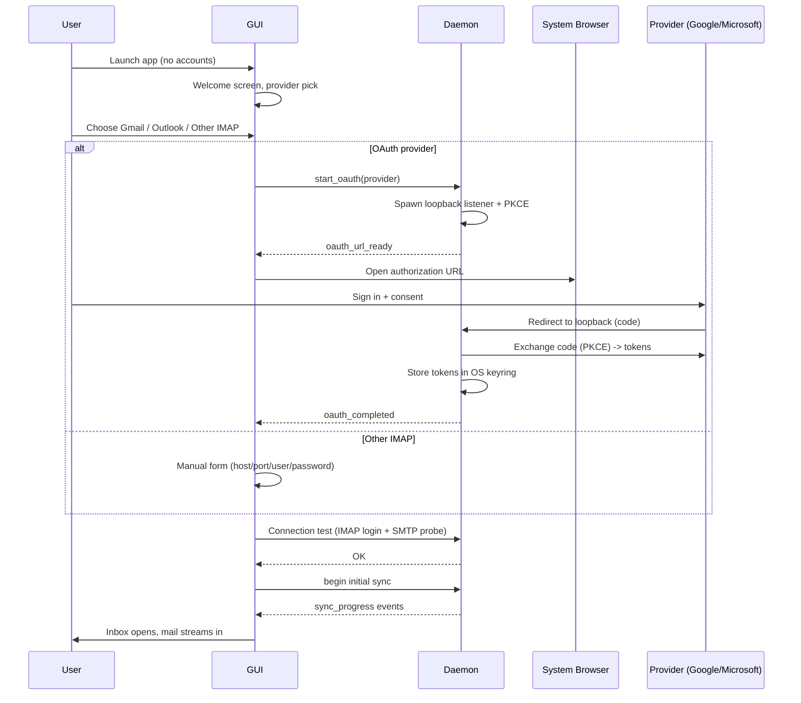

# MailSlate — User Flow Specification

| Field | Value |
| --- | --- |
| Version | 1.0 |
| Date | 2026-10-16 |
| Status | Approved for implementation |
| Related | [PRD](./PRD.md) · [ARCHITECTURE](./ARCHITECTURE.md) · [DESIGN](./DESIGN.md) · [DESIGN-cal source](./DESIGN-cal.md) |

This document defines every user-facing flow in MailSlate v1: the app shell layout, per-flow
steps and states, the keyboard map, and the state matrix for each view. Feature IDs (F1–F10)
reference the [PRD](./PRD.md).

---

## 1. Principles

1. **Three-pane desktop shell.** Sidebar, conversation list, reader. Keyboard-first, mouse-optional.
2. **Optimistic UI.** Every mutation (flag, move, delete, tag, send) applies locally at once and
   drains through the daemon outbox. The UI never blocks on the network.
3. **Offline-first.** All synced mail is readable and searchable offline. Mutations queue and replay.
4. **Daemon continuity.** The sync engine and notifications live in the daemon, not the GUI. Closing
   the GUI window does not stop mail, notifications, or queued operation draining.
5. **Calm chrome.** Monochrome action layer, hairline dividers, no decorative noise (see DESIGN.md).
6. **No dead ends.** Every failure state shows a recovery action inline (retry, reconnect, edit
   settings) — never a silent failure.

---

## 2. Window anatomy

```
┌────────────────────────────────────────────────────────────────────┐
│ Sidebar (240px fixed)   │ Conversation list (~380px) │ Reader       │
│                         │                            │              │
│ [Compose]  [Sync state] │ Rows 44px:                 │ Thread view  │
│ Search entry            │  sender · subject · time   │  collapsed   │
│ ── Unified (all accts)  │  snippet · chips · star    │  messages;   │
│   Inbox, Starred,       │  unread dot · attachment   │  expand on   │
│   Drafts, Sent,         │  icon · hover checkbox     │  click;      │
│   Important*, Spam,     │                            │  quote chips │
│   Trash                 │                            │              │
│ ── Accounts (grouped)   │                            │              │
│   <account> color dot   │                            │              │
│    mailboxes + tags     │                            │              │
│ ── Settings             │                            │              │
└────────────────────────────────────────────────────────────────────┘
```

- Minimum window size: 1024 × 640 logical px. Panes keep fixed proportions at minimum size.
- `*` Important appears only when at least one connected account exposes it (Gmail). Hidden
  otherwise — never shown as an empty state.
- The unified group (All Accounts) and per-account groups share the view. Sidebar section
  headers are collapsible; collapse state persists per profile.
- Composer opens as a **full-pane in-app route** replacing the reader column (not a second OS
  window — multi-window is a documented follow-up).
- Account color dot: deterministic palette color from the badge pastel set (DESIGN.md §5.4).

---

## 3. First run & account onboarding (F1)



1. **Welcome.** Centered display-sm headline, one-line value statement, two buttons:
   `Connect account` (primary) and `Explore offline` (secondary, disabled when no data exists).
2. **Provider pick.** Three cards: Gmail, Outlook, Other IMAP. Each card states what happens next.
3. **OAuth path.** GUI shows a waiting state ("Complete sign-in in your browser…") with a
   `Reopen browser link` fallback. The daemon owns the loopback listener; the success page in the
   browser says "You can close this tab."
   - Failure: denied consent → return to provider pick with inline note. Loopback timeout (2 min)
     → `Try again`.
4. **Other IMAP path.** Form with presets (Yahoo, Fastmail, iCloud, custom). Fields: host, port,
   security (SSL/STARTTLS), username, password, optional SMTP overrides. `Test connection` runs
   IMAP login + SMTP probe before saving; errors render inline per field.
5. **Connection test.** One progress row with two steps (IMAP ✓ / SMTP ✓). Failure keeps the form
   open with the failing step expanded.
6. **Initial sync.** Inbox is synced first; other mailboxes follow in priority order. The list
   renders progressively — user can read while syncing. Sidebar shows per-mailbox sync spinner.
7. **Second and further accounts.** Same flow via Settings → Accounts → `Add account` or sidebar
   `+`. Unified group updates immediately.
8. After the first account is added, `Start at login` is enabled by default (Settings toggle).

---

## 4. Daily read loop (F4)

1. **Open.** App focuses list; rows are unread-aware (bold sender/subject, unread dot).
2. **Navigate.** ↑/↓ move selection with a preview in the reader; `Enter` opens the thread
   (focus moves to reader). `Esc` returns focus to the list.
3. **Thread view.** Messages render newest-last with collapsed quotes (`…` chip expands). Unread
   count clears; the whole thread marks read after the reader shows it (batched, debounced — a
   fast pass-through list does not mark everything read).
4. **Attachments.** Chips under the message header (name + size + type icon). Click → download to
   temp/cache and open with the system handler; `Save as…` writes to disk. Blobs download on
   demand only.
5. **Links.** Open in the system browser. Remote images blocked by default; per-message
   `Show images` and per-sender allow-list.
6. **Reply/forward.** Buttons + `r`/`f` open the composer prefilled (see §6).
7. **Snooze/calendar** do not exist in v1.

---

## 5. Triage & organization (F3, F6)

- **Multi-select.** Hover checkbox or `Shift+↑/↓`/`Shift+Click` ranges; `Cmd/Ctrl+A` selects the
  loaded list scope. Selection survives scroll (keyset pagination).
- **Bulk bar.** Appears above the list: archive, delete, star, mark read/unread, tag, move,
  spam/junk. All actions optimistic; the bar shows counts.
- **Archive.** Gmail: removes `INBOX` label (stays in All Mail). Generic IMAP: moves to the
  Archive folder (created server-side if missing).
- **Delete.** Moves to Trash. Delete inside Trash = permanent (with confirm dialog — destructive
  confirmations use explicit wording, normal capitalization).
- **Spam.** Moves to Spam (Gmail: `SPAM` label + junk semantics; IMAP: server Spam special-use).
- **Star.** `s` toggles; star also surfaces the message in Starred view.
- **Tags.** Assign via bulk bar or reader header. Gmail labels appear as tags and round-trip to
  the server; local-only tags never leave the device (marked with a device glyph).
- **Move to folder** via context menu (right-click) or bulk bar.
- Drag-and-drop: v2.

---

## 6. Compose & send (F5)

1. **Entry.** `c` (new), `r` (reply), `a` (reply-all), `f` (forward), or the Compose button.
   Opens the composer as a full-pane route; the list stays visible behind on narrow widths as a
   breadcrumb row (`Back to Inbox`).
2. **Fields.** To/Cc/Bcc: chip inputs with recency-first autocomplete from local contacts (message
   history). Empty subject allowed with a hint. Plaintext body in v1.
3. **Attachments.** `Attach` opens the system file picker; files are staged by the daemon
   (`stage_attachment`) and appear as chips with size; large files show progress.
4. **Draft autosave.** Every 3s of idle edits and on close/navigate-away: saved locally at once,
   pushed to the server Drafts folder (APPEND) in the background. Reopening resumes exactly.
5. **Send.** `Cmd/Ctrl+Enter` or Send button:
   - Message moves to Sent optimistically and the composer closes.
   - Outbox carries the SMTP send with the stamped `Message-ID`.
   - Success: silent. Failure: a retry card appears in the Sent view row and a non-blocking toast
     with `Retry` / `Open in Drafts` actions.
   - Gmail: server auto-saves to Sent — no duplicate APPEND. Others: APPEND `\Seen` to Sent.
6. **Discard.** Closing with content beyond the initial reply stub keeps the draft (no modal);
   an explicit `Discard` action in the composer overflow deletes it with a one-step confirmation.
7. Undo-send is a documented follow-up (v2).

---

## 7. Search (F7)

1. **Entry.** `Cmd/Ctrl+F` focuses the search entry; typing switches the list into Search results
   across the current scope (unified or a single account).
2. **As-you-type.** 150 ms debounce; FTS5 prefix + bm25 ranking; results appear grouped by
   relevance with snippets (matched terms highlighted).
3. **Syntax subset.** `from:`, `to:`, `subject:`, `in:`, `tag:`, `is:unread`, `is:starred`,
   `has:attachment`. Unknown operators are treated as literals with a subtle hint chip.
4. **Filter chips.** Account, tag, unread, has:attachment — combinable, visible above results,
   individually removable.
5. **States.** Empty query → recent searches (local). No results → type-led empty state with the
   parsed query shown (`0 results for …`). Offline → still works (FTS5 is local); a small
   `offline results` note appears if sync is paused.

---

## 8. Notifications & tray (F8)

```mermaid
sequenceDiagram
  participant D as Daemon
  participant OS as OS Notification Center
  participant G as GUI
  D->>D: IDLE push: new Inbox message
  D->>D: Store; suppression check (GUI focused on same thread?)
  alt GUI running and focused on thread
    D-->>G: skip OS notification
  else notify
    D->>OS: Native notification (sender, subject, snippet)
    U->>OS: Click
    alt GUI running
      OS->>G: Focus window + open thread
    else GUI closed
      OS->>D: click callback
      D->>G: Spawn GUI --open-thread <id>
    end
  end
```

- Notifications fire from the daemon for **new Inbox mail only** (never self-sent, never Spam),
  per-account toggle (default on).
- Click → GUI focuses (existing instance) and opens the thread, or spawns the GUI with the thread
  preselected. Cold start opens on the thread once data is loaded.
- Tray icon (unread count badge, menu: Open MailSlate, Pause notifications, Quit daemon) is a
  stretch item for M5 — the spec treats it as optional, never required for notifications.

---

## 9. Offline & recovery (F9)

| Situation | UI |
| --- | --- |
| Network down | Amber `Offline — changes will send when reconnected` banner; app fully usable |
| Mutations queued | Banner counts queued operations; outbox drains automatically on reconnect |
| OAuth expired | Reader/list still work; inline `Reconnect <account>` card → re-runs OAuth in background |
| IMAP auth rejected | Account row shows error state; Explore → settings edit; outbox paused for that account |
| Sync conflict (server changed flags) | Server wins; local list silently reconciles on refresh |
| Daemon not running | GUI tries to spawn it; if spawn fails: `Sync paused — daemon unavailable` card with `Retry` and `View log` |
| Storage full (blob write fail) | Message still readable without attachment; `Attachment unavailable — storage full` chip |
| Send failed (ambiguous timeout) | Marked failed; `Retry` resends with same Message-ID (server dedupe) |

---

## 10. Settings & lifecycle (F10)

- **Accounts.** Add account, per-account: sync window, signature? (v2), notifications toggle,
  remove account (choice: `Keep local data` / `Delete local data` with destructive confirmation).
- **Appearance.** Theme: System / Light / Dark (default System).
- **Notifications.** Per-account toggles; `Start at login` toggle (writes systemd user unit /
  LaunchAgent / Run key; no admin rights required).
- **Daemon.** Status row (running, uptime, last sync, version), `Restart daemon`, `Stop daemon`.
- **Quit semantics.** Closing the GUI quits the UI only — daemon keeps syncing and notifying.
  Menu `Quit MailSlate` does the same. `Stop daemon` (Settings or tray) is the only way to end
  background mail; it asks for confirmation once and notes notifications will stop.
- **About.** Version, protocol version, licenses, log folder link.

---

## 11. Keyboard map (v1)

| Key | Action |
| --- | --- |
| `↑` `↓` | Move selection in list |
| `Enter` | Open thread (focus reader) |
| `Esc` | Back to list / close composer prompt |
| `e` | Archive |
| `#` | Delete (Trash; permanent inside Trash with confirm) |
| `s` | Star / unstar |
| `u` | Toggle read / unread |
| `!` | Toggle spam / junk |
| `r` / `a` / `f` | Reply / Reply all / Forward |
| `c` | New message |
| `Cmd/Ctrl+Enter` | Send (in composer) |
| `Cmd/Ctrl+F` | Search (`/` also focuses search) |
| `Cmd/Ctrl+R` | Sync now (current account) |
| `Cmd/Ctrl+,` | Settings |
| `Cmd/Ctrl+N` | New message (alias of `c`) |

Platform substitution: `Cmd` on macOS, `Ctrl` on Linux/Windows. Full remapping is v2.

---

## 12. View state matrix

Each view must define exactly these states:

| View | Loading | Empty | Error | Offline |
| --- | --- | --- | --- | --- |
| Conversation list | Skeleton rows (no spinner) | Type-led empty: view name + hint (`Inbox is empty`) | Inline retry row at top of list | Cached rows + offline banner |
| Reader | Message skeleton (header + 3 lines) | `Select a conversation` placeholder | `Could not load message — Retry` | Cached body renders normally |
| Search | Instant (local FTS) — no skeleton | Recent searches / no-results copy | `Search unavailable` only if DB error | Works; `offline results` note |
| Sidebar counts | Counts hidden until first sync | `+ Add account` affordance | Account row error triangle + tooltip | Last known counts |
| Settings | — | — | Field-level inline errors | Full local access |
| Composer | — | — | Send-failure card + toast | `Will send when reconnected` note |

---

## 13. Accessibility

- Full keyboard operability per §11; visible focus state everywhere (2px accent ring per DESIGN.md).
- Screen-reader labels on list rows: sender, subject, received time, unread/starred/attachment
  state; bulk bar announces selection count.
- Contrast ≥ 4.5:1 for text in both themes; UI states are never color-only (unread = dot + weight,
  star = filled glyph, errors = icon + text).
- Reduced motion: respects OS setting — transitions become instant (transition tokens in DESIGN.md).

---

## 14. Cross-links

- Feature IDs and acceptance criteria: [PRD](./PRD.md) §6.
- Daemon lifecycle, IPC, sync engine, notification click mechanics: [ARCHITECTURE](./ARCHITECTURE.md)
  §2, §5, §9.
- Visual tokens, component specs, empty-state type: [DESIGN](./DESIGN.md).
- Icon behavior for notifications/tray: [APP_ICON](./APP_ICON.md).
